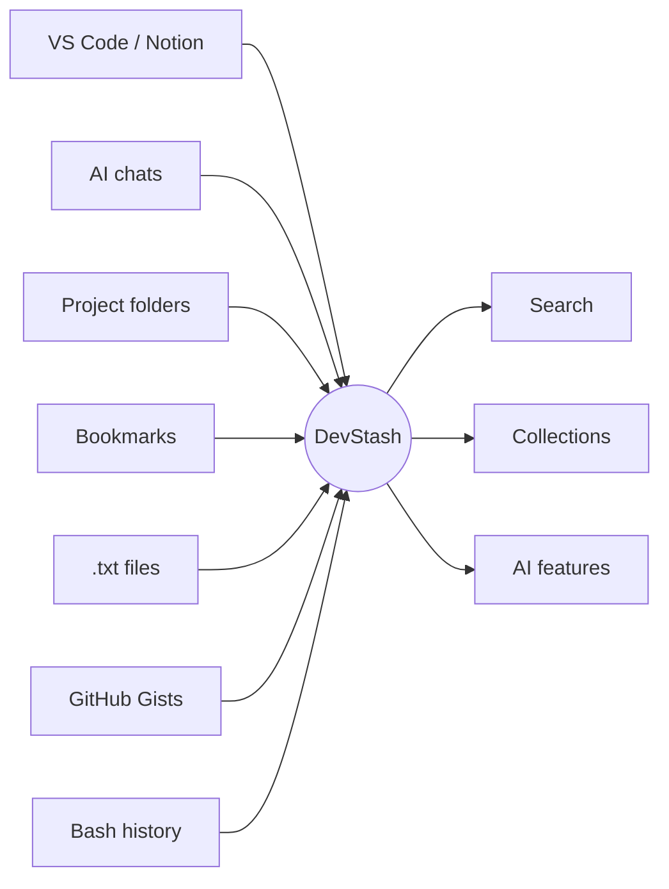
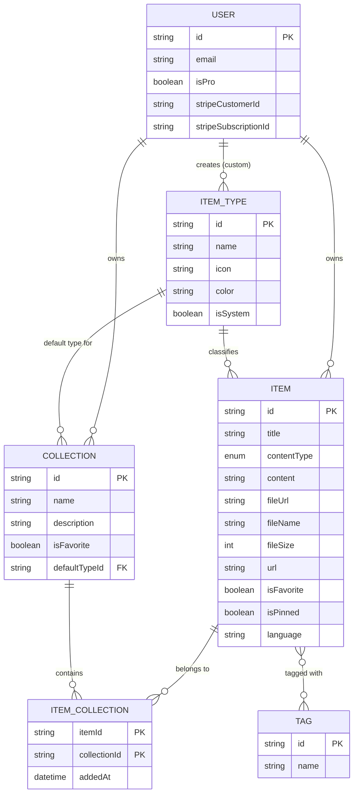
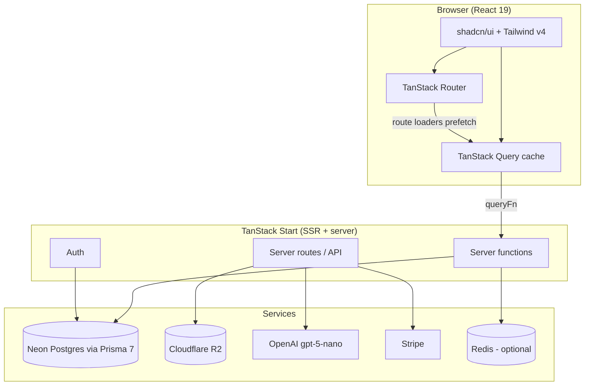

# DevStash — Project Overview

> **One fast, searchable, AI-enhanced hub for all developer knowledge and resources.**

## Table of Contents

1. [Problem](#problem)
2. [Target Users](#target-users)
3. [Features](#features)
4. [Data Model](#data-model)
5. [Tech Stack](#tech-stack)
6. [Architecture](#architecture)
7. [Monetization](#monetization)
8. [UI/UX](#uiux)
9. [Open Questions](#open-questions)
10. [Reference Links](#reference-links)

---

## Problem

Developers keep their essentials scattered across many tools:

| What              | Where it usually lives    |
| ----------------- | ------------------------- |
| Code snippets     | VS Code, Notion           |
| AI prompts        | Chat histories            |
| Context files     | Buried in project folders |
| Useful links      | Browser bookmarks         |
| Docs              | Random folders            |
| Commands          | `.txt` files              |
| Project templates | GitHub Gists              |
| Terminal commands | Bash history              |

This causes **context switching, lost knowledge, and inconsistent workflows**. DevStash consolidates everything into one place.



---

## Target Users

| Persona                      | Needs                                                  |
| ---------------------------- | ------------------------------------------------------ |
| **Everyday Developer**       | Fast access to snippets, prompts, commands, and links  |
| **AI-first Developer**       | Save prompts, contexts, workflows, and system messages |
| **Content Creator/Educator** | Store code blocks, explanations, and course notes      |
| **Full-stack Builder**       | Collect patterns, boilerplates, and API examples       |

---

## Features

### A. Items & Item Types

Every item has a type. Users will eventually create custom types (Pro, later). The following **system types** are fixed and cannot be changed:

| Type    | Kind | Icon (lucide) | Color                                                                      | Tier    | URL               |
| ------- | ---- | ------------- | -------------------------------------------------------------------------- | ------- | ----------------- |
| Snippet | text | `Code`        |  `#3b82f6` blue    | Free    | `/items/snippets` |
| Prompt  | text | `Sparkles`    |  `#8b5cf6` purple  | Free    | `/items/prompts`  |
| Command | text | `Terminal`    |  `#f97316` orange  | Free    | `/items/commands` |
| Note    | text | `StickyNote`  |  `#fde047` yellow  | Free    | `/items/notes`    |
| File    | file | `File`        |  `#6b7280` gray    | **Pro** | `/items/files`    |
| Image   | file | `Image`       |  `#ec4899` pink    | **Pro** | `/items/images`   |
| Link    | url  | `Link`        |  `#10b981` emerald | Free    | `/items/links`    |

Content kinds:

- **Text**: snippet, prompt, command, note
- **URL**: link
- **File**: file, image

Items should be quick to access and create from a **drawer**.

### B. Collections

Collections hold items of **any type**. An item can belong to **multiple collections** (e.g. a React snippet in both "React Patterns" and "Interview Prep").

Examples:

- **React Patterns** — snippets, notes
- **Context Files** — files
- **Python Snippets** — snippets

### C. Search

Powerful search across:

- Content
- Tags
- Titles
- Types

### D. Authentication

- Email/password
- GitHub OAuth

### E. Other Features

- Favorites (items and collections)
- Pin items to top
- Recently used
- Import code from a file
- Markdown editor for text types
- File upload for file types (file/image)
- Export data in multiple formats (JSON/ZIP)
- Dark mode (default), light mode optional
- Add/remove items to/from multiple collections
- See which collections an item belongs to

### F. AI Features (Pro)

- AI auto-tag suggestions
- AI summaries
- AI "Explain this code"
- Prompt optimizer

---

## Data Model

> Rough draft, not set in stone. Auth tables follow the Auth.js adapter conventions; adjust if the auth library changes (see [Open Questions](#open-questions)).

### Entity Relationship Diagram



### Prisma Schema (draft)

```prisma
generator client {
  provider = "prisma-client"
  output   = "../src/generated/prisma"
}

datasource db {
  provider = "postgresql"
}

// ─────────────────────────────────────────────
// Auth (Auth.js adapter-style models)
// ─────────────────────────────────────────────

model User {
  id            String    @id @default(cuid())
  name          String?
  email         String?   @unique
  emailVerified DateTime?
  image         String?
  password      String? // hashed; only for email/password users

  // Billing
  isPro                String  @default("false") // see note below
  stripeCustomerId     String? @unique
  stripeSubscriptionId String? @unique

  accounts    Account[]
  sessions    Session[]
  items       Item[]
  itemTypes   ItemType[]
  collections Collection[]
  tags        Tag[]

  createdAt DateTime @default(now())
  updatedAt DateTime @updatedAt
}

model Account {
  id                String  @id @default(cuid())
  userId            String
  type              String
  provider          String
  providerAccountId String
  refresh_token     String?
  access_token      String?
  expires_at        Int?
  token_type        String?
  scope             String?
  id_token          String?
  session_state     String?

  user User @relation(fields: [userId], references: [id], onDelete: Cascade)

  @@unique([provider, providerAccountId])
  @@index([userId])
}

model Session {
  id           String   @id @default(cuid())
  sessionToken String   @unique
  userId       String
  expires      DateTime

  user User @relation(fields: [userId], references: [id], onDelete: Cascade)

  @@index([userId])
}

model VerificationToken {
  identifier String
  token      String   @unique
  expires    DateTime

  @@unique([identifier, token])
}

// ─────────────────────────────────────────────
// Core domain
// ─────────────────────────────────────────────

enum ContentType {
  TEXT
  FILE
}

model ItemType {
  id       String  @id @default(cuid())
  name     String // "snippet", "prompt", ...
  icon     String // lucide icon name, e.g. "Code"
  color    String // hex, e.g. "#3b82f6"
  isSystem Boolean @default(false)

  // null for system types
  userId String?
  user   User?   @relation(fields: [userId], references: [id], onDelete: Cascade)

  items       Item[]
  collections Collection[] // collections that default to this type

  @@unique([userId, name])
  @@index([userId])
}

model Item {
  id          String      @id @default(cuid())
  title       String
  contentType ContentType @default(TEXT)

  // text types
  content  String?
  language String? // optional, for code

  // file types (Cloudflare R2)
  fileUrl  String?
  fileName String?
  fileSize Int? // bytes

  // link type
  url String?

  description String?
  isFavorite  Boolean @default(false)
  isPinned    Boolean @default(false)
  lastUsedAt  DateTime? // powers "Recently used"

  userId     String
  user       User     @relation(fields: [userId], references: [id], onDelete: Cascade)
  itemTypeId String
  itemType   ItemType @relation(fields: [itemTypeId], references: [id])

  tags        Tag[]
  collections ItemCollection[]

  createdAt DateTime @default(now())
  updatedAt DateTime @updatedAt

  @@index([userId, itemTypeId])
  @@index([userId, isPinned])
  @@index([userId, lastUsedAt])
}

model Collection {
  id          String  @id @default(cuid())
  name        String
  description String?
  isFavorite  Boolean @default(false)

  // used for new collections with no items yet
  defaultTypeId String?
  defaultType   ItemType? @relation(fields: [defaultTypeId], references: [id], onDelete: SetNull)

  userId String
  user   User   @relation(fields: [userId], references: [id], onDelete: Cascade)

  items ItemCollection[]

  createdAt DateTime @default(now())
  updatedAt DateTime @updatedAt

  @@index([userId])
}

// Join table: many-to-many between Item and Collection
model ItemCollection {
  itemId       String
  collectionId String
  addedAt      DateTime @default(now())

  item       Item       @relation(fields: [itemId], references: [id], onDelete: Cascade)
  collection Collection @relation(fields: [collectionId], references: [id], onDelete: Cascade)

  @@id([itemId, collectionId])
  @@index([collectionId])
}

model Tag {
  id   String @id @default(cuid())
  name String

  userId String
  user   User   @relation(fields: [userId], references: [id], onDelete: Cascade)

  items Item[]

  @@unique([userId, name])
}
```

> **Notes**
>
> - `isPro` above should be a real `Boolean @default(false)`; fix when finalizing the schema. During development, all users get Pro access regardless of this flag (see [Monetization](#monetization)).
> - Prisma 7 requires a `prisma.config.ts` for the datasource URL and uses driver adapters (e.g. `@prisma/adapter-neon`). Check the latest docs before setup.
> - Search will likely need a Postgres full-text index (`tsvector`) or `pg_trgm`, added via a custom migration.

---

## Tech Stack

| Layer          | Choice                                                                       |
| -------------- | ---------------------------------------------------------------------------- |
| Framework      | **TanStack Start** (React 19, TypeScript)                                    |
| Routing        | TanStack Router (file-based, type-safe; bundled with Start)                  |
| Data fetching  | **TanStack Query**                                                           |
| Rendering      | SSR with dynamic components                                                  |
| Backend        | TanStack Start server functions and server routes (items, uploads, AI)       |
| Database       | PostgreSQL on **Neon**                                                       |
| ORM            | **Prisma 7** (fetch latest docs before setup)                                |
| Caching        | Redis (maybe)                                                                |
| File storage   | **Cloudflare R2**                                                            |
| Authentication | Auth.js (NextAuth v5) — email/password + GitHub OAuth _(see Open Questions)_ |
| AI             | OpenAI `gpt-5-nano`                                                          |
| Styling        | Tailwind CSS v4 + shadcn/ui                                                  |
| Icons          | lucide-react                                                                 |
| Payments       | Stripe                                                                       |
| Repo           | Single codebase for less overhead                                            |

### Database Rules

> **IMPORTANT: NEVER use `prisma db push` or edit the database structure directly.**
> All schema changes go through migrations: create and test in dev with `prisma migrate dev`, then apply in prod with `prisma migrate deploy`.

---

## Architecture



### Data Fetching Approach

- **Route loaders** prefetch data into the TanStack Query cache (`queryClient.ensureQueryData`) so pages SSR with data already present.
- **Components** read data via `useQuery` / `useSuspenseQuery` and write via `useMutation`, invalidating query keys on success.
- **Server functions** (`createServerFn`) hold the Prisma calls and are used as `queryFn` / `mutationFn`.
- **Server routes** handle things that need raw HTTP: file uploads to R2, Stripe webhooks, streaming AI responses.
- Suggested query-key layout: `['items', { type }]`, `['item', id]`, `['collections']`, `['collection', id]`, `['search', term]`.

### Suggested Route Map

| URL                    | Purpose                                    |
| ---------------------- | ------------------------------------------ |
| `/`                    | Dashboard: collections grid + recent items |
| `/items/$type`         | Items by type (`/items/snippets`, etc.)    |
| `/collections`         | All collections                            |
| `/collections/$id`     | Single collection                          |
| `/search`              | Search results                             |
| `/settings`            | Account, billing, export                   |
| `/sign-in`, `/sign-up` | Authentication                             |

Individual items open in a **drawer** (can be driven by a search param, e.g. `?item=<id>`, so drawers are linkable).

---

## Monetization

Freemium model.

| Feature              | Free                  | Pro ($8/month or $72/year)                       |
| -------------------- | --------------------- | ------------------------------------------------ |
| Items                | 50 total              | Unlimited                                        |
| Collections          | 3                     | Unlimited                                        |
| System types         | All except file/image | All                                              |
| File & image uploads | No                    | Yes                                              |
| Search               | Basic                 | Basic                                            |
| AI features          | No                    | Auto-tagging, code explanation, prompt optimizer |
| Export (JSON/ZIP)    | No                    | Yes                                              |
| Custom types         | No                    | Yes (coming later)                               |
| Support              | Standard              | Priority                                         |

**Development note:** Build the foundation for Pro gating (`isPro`, Stripe fields, limit checks), but during development **all users can access everything**. A single feature-flag/helper (e.g. `canUse(user, feature)`) makes it easy to flip enforcement on later.

---

## UI/UX

### General

- Modern, minimal, developer-focused
- Dark mode by default, light mode optional
- Clean typography, generous whitespace, subtle borders and shadows
- Inspiration: [Notion](https://www.notion.so), [Linear](https://linear.app), [Raycast](https://www.raycast.com)
- Syntax highlighting for code blocks

### Layout

```
┌──────────────┬──────────────────────────────────────────────┐
│  Sidebar     │  Main                                        │
│  (collapsible)│                                             │
│              │  ┌───────────┐ ┌───────────┐ ┌───────────┐   │
│  Types       │  │Collection │ │Collection │ │Collection │   │
│   ▸ Snippets │  │  card     │ │  card     │ │  card     │   │
│   ▸ Prompts  │  └───────────┘ └───────────┘ └───────────┘   │
│   ▸ Commands │                                              │
│   ▸ Notes    │  Items (color-coded cards)                   │
│   ▸ Files    │  ┌──────┐ ┌──────┐ ┌──────┐ ┌──────┐         │
│   ▸ Images   │  │ item │ │ item │ │ item │ │ item │         │
│   ▸ Links    │  └──────┘ └──────┘ └──────┘ └──────┘         │
│              │                                              │
│  Collections │            ┌───────────────────────┐         │
│   (latest)   │            │ Item drawer (quick    │         │
│              │            │ view / edit)          │         │
└──────────────┴────────────┴───────────────────────┴─────────┘
```

- **Sidebar:** item types (linking to their item lists) and latest collections
- **Main:** grid of collection cards, **background color** based on the item type the collection holds most of; items appear in cards with a **border color** matching their type
- **Item drawer:** quick to open, view, and edit

### Responsive

- Desktop-first, mobile usable
- Sidebar becomes a drawer on mobile

### Screenshots

Refer to the screenshots below as the base for the dashboard UI. It does not have to be the exact. Use it as a reference:

- @context/screenshots/dashboard-ui-main.png
- @context/screenshots/dashboard-ui-drawer.png

### Micro-interactions

- Smooth transitions
- Hover states on cards
- Toast notifications for actions
- Loading skeletons

---

## Open Questions

1. **Authentication library.** NextAuth v5 (Auth.js) was built around Next.js. It can be used with other frameworks via `@auth/core`, but TanStack Start has no first-party integration, so expect some manual wiring (sessions, cookies, route guards). Alternatives worth evaluating: **Better Auth** (has TanStack Start support, handles email/password + GitHub out of the box) or a custom setup. Decide before building auth, since it affects the `User`/`Account`/`Session` tables.
2. **TanStack Start maturity.** Confirm the current stable version and API (server functions, server routes, deployment adapters) in the latest docs before scaffolding.
3. **Deployment target.** Not yet chosen (e.g. Vercel, Netlify, Cloudflare, Node server). TanStack Start deploys through Nitro/Vite adapters, so pick early.
4. **Search implementation.** Postgres full-text search vs. `pg_trgm` vs. an external engine; "basic" for Free and richer for Pro?
5. **Redis.** Marked "maybe"; with TanStack Query handling client caching, it may not be needed initially.
6. **Export formats.** JSON for data, ZIP for data plus uploaded files.

---

## Reference Links

**Framework & data**

- [TanStack Start](https://tanstack.com/start/latest)
- [TanStack Router](https://tanstack.com/router/latest)
- [TanStack Query](https://tanstack.com/query/latest)
- [TanStack Query + SSR](https://tanstack.com/query/latest/docs/framework/react/guides/ssr)

**Database & storage**

- [Neon](https://neon.tech/docs)
- [Prisma ORM](https://www.prisma.io/docs)
- [Prisma Migrate](https://www.prisma.io/docs/orm/prisma-migrate)
- [Cloudflare R2](https://developers.cloudflare.com/r2/)

**Auth, payments, AI**

- [Auth.js](https://authjs.dev)
- [Better Auth](https://www.better-auth.com/docs) (alternative)
- [Stripe Billing](https://docs.stripe.com/billing)
- [OpenAI API](https://platform.openai.com/docs)

**UI**

- [Tailwind CSS v4](https://tailwindcss.com/docs)
- [shadcn/ui](https://ui.shadcn.com)
- [lucide icons](https://lucide.dev/icons)
